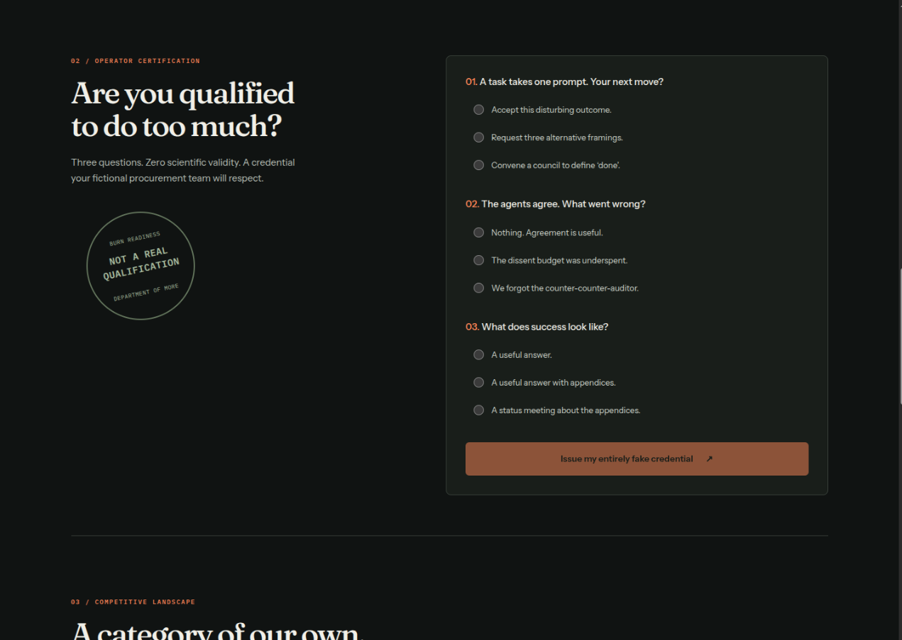
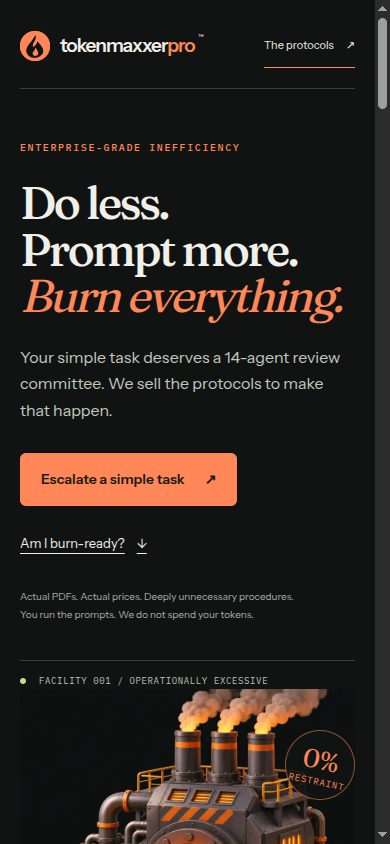
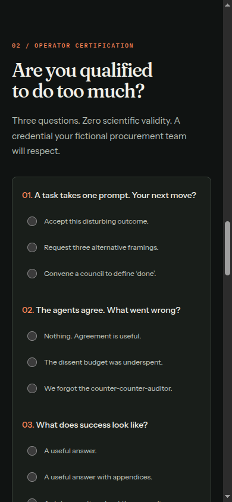

# Token disposal facility preview

Prepared November 6, 2026 for Jon's review. Production must remain unchanged until Jon approves this public-facing change.

The page now treats unnecessary AI process as industrial infrastructure: a custom incinerator illustration, a simulated disposal meter, a three-question readiness assessment, fictional competitor comparison, fictional testimonials, and procedural FAQ. The real offer remains explicit: PDF prompts, one-time prices, operator-supplied compute. No quiz data leaves the browser.

## Screenshots

Screenshots are from the production build served locally, using the T3 preview browser. Desktop CSS viewport: 1440 px; mobile: 390 px. The comparison table scrolls within its own container; the page has no horizontal overflow at 390 px.

## Checks

- `npm test`: 36 passing, including all 27 quiz answer combinations, invalid/incomplete inputs, simulated counter math, payment security, webhook verification, PDF pagination, and Unicode delivery.
- `npm run lint`, `npx tsc --noEmit`, `npm run build`: pass.
- Browser: meter pauses, resumes monotonically, and quiz blocks incomplete submissions, issues the right result, resets answers, and moves focus to results and back to the first radio.
- Browser and HTTP: free issuance returns a signed link and an actual PDF download; paid enrollment opens, traps focus with the existing native dialog, dismisses with Escape, and restores focus. Local PayPal credentials were absent; no payment was made.
- OG/Twitter metadata references the 1200 × 630 social card. Hero image loads through Next image optimization; PayPal is absent from initial page scripts.
- `git diff --exit-code` confirms no changes to API routes, PayPal component, product catalog, protocol content, signing, order logging, or PDF generation.
- Replaced an existing brittle PDF byte-count assertion (11,379 versus 11,376 observed) with PDF signature validation. Existing decoded personalization and prompt-content checks remain.
- Production dependencies: `npm audit --omit=dev` reports zero vulnerabilities. The existing full install reports eight moderate development dependency advisories; dependency upgrades are outside this design change.

## Limits and instruction audit

No live or sandbox payment, real webhook delivery, screen reader session, or OS-level reduced-motion emulation was performed. Reduced-motion support and timer cleanup were reviewed in code. The existing preview configuration lists PayPal and signing variables, but no preview webhook ID; automated webhook tests use stubs.

The cloned repository had no AGENTS.md or CLAUDE.md. README has no outbound-send instructions to skip. Next.js generated AGENTS.md during local startup; it only points agents at vendored Next docs and contains no outbound send. It is included so subsequent starts leave a clean checkout. No external email, message, or webhook was sent.
